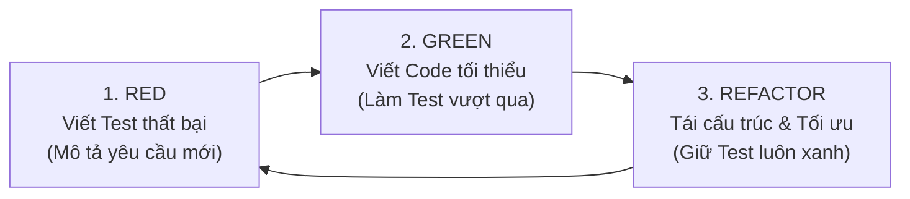

# KIỂM THỬ PHỤC VỤ THIẾT KẾ: UNIT TEST, TDD & TESTING PATTERNS
## DỰ ÁN: OTSP (.NET 10 / ASP.NET CORE)

---

### 1. NGUYÊN LÝ THIẾT KẾ PHỤC VỤ KIỂM THỬ (DESIGN FOR TESTABILITY)

Trong dự án OTSP, kiểm thử không chỉ là bước cuối cùng để "bắt lỗi" (bug catching), mà được sử dụng như một **công cụ dẫn dắt thiết kế phần mềm**:
1. **Áp dụng Dependency Inversion Principle (DIP)**: Tất cả các Controller trong OTSP không phụ thuộc trực tiếp vào tầng lưu trữ dữ liệu hay dịch vụ bên ngoài, mà phụ thuộc vào trừu tượng (Interface):
   - `ISearchService` $\leftrightarrow$ `SearchService`
   - `IChatService` $\leftrightarrow$ `ChatService`
   - `IAvailabilitySlotService` $\leftrightarrow$ `AvailabilitySlotService`
   - `IImageStorageService` $\leftrightarrow$ `CloudinaryImageStorageService`
2. **Khả năng cách ly (Test Isolation)**: Bằng cách tiêm phụ thuộc qua Constructor (Constructor Injection), các bài Unit Test có thể thay thế Database thật và Third-party Cloud bằng các **Test Doubles** (Mock / In-Memory Db) mà không cần can thiệp mã nguồn chính.

---

### 2. QUY TRÌNH PHÁT TRIỂN HƯỚNG KIỂM THỬ (TDD - TEST-DRIVEN DEVELOPMENT)

Quy trình TDD được thực hiện theo chu trình 3 bước lặp **Red — Green — Refactor**:



#### Case Study thực tế trong OTSP: Nghiệp vụ "Chặn gửi tin nhắn chat rỗng"
- **Bước 1 (RED)**: Viết test `SendMessageAsync_WhenContentIsWhitespaceOrNull_ShouldThrowArgumentException` trong file `ChatServiceTests.cs`. Lúc này chưa có code kiểm tra độ dài chuỗi $\to$ Chạy test bị **FAIL (Đỏ)**.
- **Bước 2 (GREEN)**: Mở `ChatService.cs`, bổ sung đoạn code validation đơn giản:
  ```csharp
  var normalizedContent = content?.Trim();
  if (string.IsNullOrWhiteSpace(normalizedContent) || normalizedContent.Length > MaxMessageLength)
      throw new ArgumentException($"Tin nhắn phải có từ 1 đến {MaxMessageLength} ký tự.", nameof(content));
  ```
  Chạy lại test $\to$ Test **PASS (Xanh)**.
- **Bước 3 (REFACTOR)**: Chuyển hằng số `MaxMessageLength = 2000` thành hằng số dùng chung, dọn dẹp biến thừa, đảm bảo mã nguồn sạch sẽ mà vẫn xanh 100%.

---

### 3. CÁC TESTING PATTERNS ĐƯỢC CÀI ĐẶT TRONG THƯ MỤC `Tests/`

#### 3.1. Cấu trúc bài test AAA Pattern (Arrange — Act — Assert)
Mọi bài kiểm thử trong dự án đều được phân tách rõ ràng thành 3 khối mạch lạc:
- **Arrange**: Chuẩn bị CSDL in-memory, khởi tạo Builder, nạp tham số đầu vào.
- **Act**: Thực thi phương thức cần kiểm thử (gọi hàm service).
- **Assert**: Sử dụng thư viện **FluentAssertions** để khẳng định tính đúng đắn với câu lệnh mang tính tự nhiên (`result.Should().NotBeNull()`, `result.Total.Should().Be(1)`).

#### 3.2. Test Doubles (Đối tượng đóng thế)
- **Fake Database**: Sử dụng `Microsoft.EntityFrameworkCore.InMemory` qua `TestDbContextFactory` để giả lập trọn vẹn hành vi truy vấn Entity Framework Core mà không cần cài đặt CSDL thật khi chạy test.
- **Mocking**: Sử dụng thư viện **Moq** để giả lập các Interface phụ thuộc như `IMemoryCache`, `IHubContext<ChatHub>`, kiểm tra số lần phương thức được gọi.

#### 3.3. Test Data Builder Pattern
Thay vì phải tạo thủ công đối tượng `TutorProfile` hoặc `ClassSession` với hàng chục thuộc tính phức tạp ở mỗi bài test, dự án xây dựng các lớp Builder riêng biệt trong thư mục `Tests/Builders/`:
- [`TutorProfileBuilder.cs`](file:///c:/tai_lieu_hoc_thuat_cua_tuan/mauthietkephanmem/OTSP/PROJECT_OTSP/Tests/Builders/TutorProfileBuilder.cs)
- [`ClassSessionBuilder.cs`](file:///c:/tai_lieu_hoc_thuat_cua_tuan/mauthietkephanmem/OTSP/PROJECT_OTSP/Tests/Builders/ClassSessionBuilder.cs)
- [`ConnectionRequestBuilder.cs`](file:///c:/tai_lieu_hoc_thuat_cua_tuan/mauthietkephanmem/OTSP/PROJECT_OTSP/Tests/Builders/ConnectionRequestBuilder.cs)

**Ví dụ sử dụng Fluent Builder:**
```csharp
var activeTutor = new TutorProfileBuilder()
    .WithId(10)
    .WithName("Thầy Minh")
    .WithFee(180000m)
    .WithVerificationStatus(VerificationStatus.Approved)
    .WithAccountStatus(AccountStatus.Active)
    .Build();
```
*Ưu điểm*: Code test ngắn gọn, mang tính tự diễn đạt (expressive), và khi Entity thay đổi cấu trúc bảng thì chỉ cần cập nhật tại Builder duy nhất.

---

### 4. BẢNG MA TRẬN ÁNH XẠ KIỂM THỬ (TRACEABILITY MATRIX)

| Module / Lớp nghiệp vụ | Phương thức nghiệp vụ | File Unit Test tương ứng | Kịch bản kiểm thử bao phủ |
| :--- | :--- | :--- | :--- |
| **SearchService** | `SearchTutorsAsync` | `SearchServiceTests.cs` | - Lọc theo học phí tối đa (`MaxFee`)<br>- Lọc trạng thái duyệt (`Approved`)<br>- Chặn tài khoản bị khóa (`Locked`)<br>- Kiểm thử thuật toán phân trang |
| **ChatService** | `GetConversationAsync` | `ChatServiceTests.cs` | - Chặn người ngoài cuộc đọc tin nhắn<br>- Chặn khi yêu cầu kết nối chưa được duyệt |
| **ChatService** | `SendMessageAsync` | `ChatServiceTests.cs` | - Chặn tin nhắn rỗng / khoảng trắng<br>- Chặn tin nhắn vượt quá 2000 ký tự<br>- Lưu tin nhắn và trả DTO khi hợp lệ |
| **ClassSession** | Quản lý vòng đời buổi học | `ClassSessionTests.cs` | - Tự sinh phòng `VideoRoom` khi bắt đầu<br>- Chặn kết thúc buổi học đã Done<br>- Từ chối tham gia khi lớp học Inactive |
| **AvailabilitySlotService** | `GetAvailableSlotsAsync` | `AvailabilitySlotServiceTests.cs` | - Trả về mảng rỗng khi gia sư chưa đăng ký lịch<br>- Tính toán khung giờ rảnh chính xác theo ngày |

